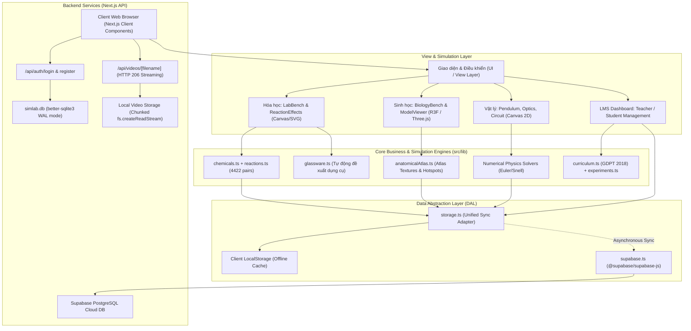
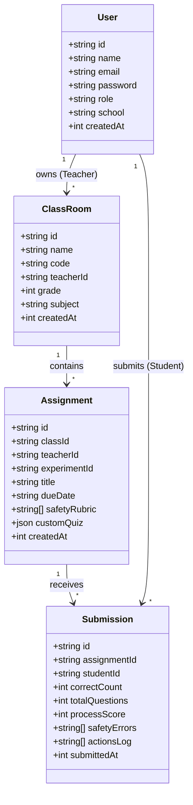
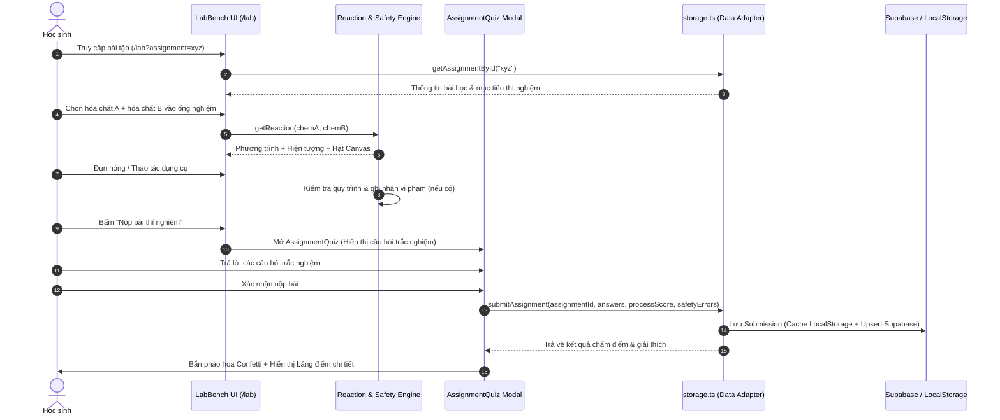

# SIMLAB — BÁO CÁO KIẾN TRÚC & TÀI LIỆU CÔNG NGHỆ CHUYÊN SÂU
**Simlab Virtual STEM Laboratory & EdTech Platform**  
*Phiên bản tài liệu: 2.0 · Cập nhật: 10/2026 · Ngôn ngữ: Tiếng Việt / Technical English*

---

## MỤC LỤC
1. [TỔNG QUAN HỆ THỐNG & ĐỊNH VỊ CÔNG NGHỆ](#1-tổng-quan-hệ-thống--định-vị-công-nghệ)
2. [MA TRẬN CÔNG NGHỆ (TECH STACK MATRIX)](#2-ma-trận-công-nghệ-tech-stack-matrix)
3. [KIẾN TRÚC TỔNG THỂ (SYSTEM ARCHITECTURE)](#3-kiến-trúc-tổng-thể-system-architecture)
4. [PHÂN HỆ THÍ NGHIỆM HÓA HỌC ẢO (CHEMISTRY SIMULATION ENGINE)](#4-phân-hệ-thí-nghiệm-hóa-học-ảo-chemistry-simulation-engine)
5. [PHÂN HỆ GIẢI PHẪU SINH HỌC 3D (3D BIOLOGY & ANATOMICAL ATLAS)](#5-phân-hệ-giải-phẫu-sinh-học-3d-3d-biology--anatomical-atlas)
6. [PHÂN HỆ MÔ PHỎNG VẬT LÝ (PHYSICS SIMULATION ENGINES)](#6-phân-hệ-mô-phỏng-vật-lý-physics-simulation-engines)
7. [KIẾN TRÚC DỮ LIỆU LAI & LƯU TRỮ (HYBRID DATA LAYER)](#7-kiến-trúc-dữ-liệu-lai--lưu-trữ-hybrid-data-layer)
8. [BẢO MẬT, XÁC THỰC & PHÂN QUYỀN (SECURITY & RBAC)](#8-bảo-mật-xác-thực--phân-quyền-security--rbac)
9. [HỆ THỐNG LMS & GAMIFICATION GIÁO DỤC](#9-hệ-thống-lms--gamification-giáo-dục)
10. [HẠ TẦNG MEDIA STREAMING (CHUNKED VIDEO PIPELINE)](#10-hạ-tầng-media-streaming-chunked-video-pipeline)
11. [QUY TRÌNH HOẠT ĐỘNG CHÍNH (SEQUENCE FLOWS)](#11-quy-trình-hoạt-động-chính-sequence-flows)
12. [HƯỚNG DẪN KIỂM THỬ, VẬN HÀNH & TRIỂN KHAI](#12-hướng-dẫn-kiểm-thử-vận-hành--triển-khai)
13. [ĐÁNH GIÁ HIỆU NĂNG & ĐỊNH HƯỚNG MỞ RỘNG](#13-đánh-giá-hiệu-năng--định-hướng-mở-rộng)

---

## 1. TỔNG QUAN HỆ THỐNG & ĐỊNH VỊ CÔNG NGHỆ

### 1.1 Sứ mệnh kỹ thuật
**Simlab** là nền tảng phòng thí nghiệm tương tác ảo đa bộ môn (Hóa học, Vật lý, Sinh học) kết hợp hệ thống quản lý học tập (LMS - Learning Management System) dành cho giáo viên và học sinh phổ thông (lớp 8–12) theo khung chuẩn **Chương trình GDPT 2018 Việt Nam**.

Về mặt công nghệ, hệ thống giải quyết 3 bài toán lõi:
1. **Mô phỏng khoa học thời gian thực (Real-time Scientific Simulation)**: Thay thế thí nghiệm vật lý/hóa chất độc hại bằng engine tương tác trực quan (Canvas 2D Particle Engine cho phản ứng hóa học, WebGL/Three.js cho giải phẫu 3D, Numerical Solvers cho cơ học/quang học/mạch điện).
2. **Đánh giá quy trình thí nghiệm thông minh (Procedural Assessment & Rubrics)**: Không chỉ chấm điểm trắc nghiệm cuối bài, hệ thống ghi nhận log thao tác, phạt điểm nếu vi phạm an toàn hóa chất (quên kính bảo hộ, đun sai dụng cụ, tràn chất), đo đạc mức độ chuẩn xác của thao tác.
3. **Mô hình Dữ liệu Lai (Hybrid Offline-First / Cloud Sync)**: Vừa có thể hoạt động độc lập không phụ thuộc Internet thông qua SQLite cục bộ và LocalStorage Cache, vừa có khả năng đồng bộ thời gian thực lên Supabase Cloud khi kết nối mạng được thiết lập.

---

## 2. MA TRẬN CÔNG NGHỆ (TECH STACK MATRIX)

| Tầng kiến trúc | Công nghệ sử dụng | Phiên bản | Mục đích & Rationale kỹ thuật |
|---|---|---|---|
| **Core Framework** | Next.js (App Router) | `14.2.0` | Server-Side Rendering (SSR), Server Components tối ưu SEO, API Routes xử lý backend, Dynamic Layouts. |
| **UI Library** | React | `18.3.0` | Quản lý state theo component, Virtual DOM, Concurrent Features, Suspense boundaries. |
| **Ngôn ngữ** | TypeScript | `5.4.0` | Đảm bảo tính toàn vẹn kiểu dữ liệu (Strict Type Checking), ngăn ngừa Runtime Type Errors trong ma trận phản ứng. |
| **3D Rendering** | Three.js + React Three Fiber (R3F) + Drei | `three@0.186`, `@react-three/fiber@8.18`, `@react-three/drei@9.122` | Khung dựng hình 3D WebGL với cấu trúc phân cấp Scene Graph, OrbitControls, Mesh Clipping, Shader & Custom Procedural Textures. |
| **2D Engine & Visuals** | HTML5 Canvas Rendering Context 2D + SVG động | Native | Xử lý hàng nghìn hạt vi mô (bọt khí, kết tủa, khói, lửa) với hiệu năng 60 FPS, không gây nghẽn DOM. |
| **Styling & Design System** | Tailwind CSS + Custom CSS Variables | `3.4.0` | Utility-first CSS, dark/light theme động, glassmorphism, keyframe animations chuẩn phần cứng (GPU-accelerated). |
| **Local Database** | Better-SQLite3 | `12.11.1` | CSDL nhúng cực nhanh tại server runtime (`simlab.db`), chế độ WAL (Write-Ahead Logging) cho tốc độ đọc/ghi vượt trội. |
| **Cloud Database** | Supabase (PostgreSQL + RLS) | `@supabase/supabase-js@2.109.0` | CSDL đám mây quan hệ chuẩn hóa, Row Level Security, JSONB cho rubric an toàn & log thao tác. |
| **Mật mã & Xác thực** | bcryptjs | `3.0.3` | Băm mật khẩu (salt rounds) một chiều an toàn cho API nội bộ (`/api/auth/*`). |
| **Hiệu ứng & Gamification** | canvas-confetti | `1.9.4` | Particle celebration khi hoàn thành bài tập, thăng cấp, nhận huy hiệu. |
| **Onboarding & Tour** | driver.js | `1.9.0` | Hướng dẫn trải nghiệm người dùng tương tác từng bước (Interactive Product Tour). |
| **Development & Scripts** | tsx, ESLint | `tsx@4.23.1` | Chạy trực tiếp TypeScript scripts phục vụ validation ma trận hóa học và sinh tài liệu. |

---

## 3. KIẾN TRÚC TỔNG THỂ (SYSTEM ARCHITECTURE)

Hệ thống được thiết kế theo kiến trúc phân tầng dạng module hóa (Modular Layered Architecture):



---

## 4. PHÂN HỆ THÍ NGHIỆM HÓA HỌC ẢO (CHEMISTRY SIMULATION ENGINE)

Phân hệ phòng thí nghiệm hóa học (`/lab`, [`LabBench.tsx`](file:///d:/simlab-master/src/components/LabBench.tsx)) là hạt nhân kỹ thuật phức tạp nhất của dự án, kết hợp mô hình hóa học định lượng, hệ thống hạt và kiểm soát an toàn nghiêm ngặt.

### 4.1 Cơ chế phân giải phản ứng (Reactivity Resolution Engine)
- **Tập dữ liệu hóa chất ([`chemicals.ts`](file:///d:/simlab-master/src/lib/chemicals.ts))**: Định nghĩa **140 hóa chất chuẩn** (kim loại, phi kim, oxit, axit, bazơ, muối, chất chỉ thị, hợp chất hữu cơ...) với cấu trúc thực thể chi tiết:
  ```typescript
  interface Chemical {
    id: string;
    name: string;
    formula: string;
    state: "liquid" | "solid" | "gas" | "powder" | "solution";
    color: string;
    hazardLevel: 0 | 1 | 2 | 3;
    hazards: ("corrosive" | "toxic" | "flammable" | "oxidizer" | "irritant")[];
    description: string;
    ph?: number;
    density?: number;
  }
  ```
- **Ma trận phản ứng ([`reactions.ts`](file:///d:/simlab-master/src/lib/reactions.ts))**:
  - Hỗ trợ **19.460 cặp phản ứng hóa học** giữa hai chất bất kỳ cùng phản ứng nhiệt phân đơn chất (`getHeatingReaction`).
  - Đi kèm **25 thí nghiệm mẫu** bám sát sách giáo khoa GDPT 2018 (từ lớp 8 đến lớp 12).
  - Mỗi phản ứng trả về phương trình hóa học (`equation`), hiện tượng quan sát thực tế (`description`), giải thích bản chất (`explanation`), danh sách sản phẩm sinh ra (`products`), loại phản ứng (`type`), lượng nhiệt giải phóng (`thermalEffect`: exothermic / endothermic), và chuỗi hiệu ứng trực quan (`effects`).
  - Hỗ trợ phản ứng phụ thuộc điều kiện: nhiệt độ phòng vs đun nóng (đèn cồn), hiện tượng hòa tan, đổi màu chất chỉ thị (quỳ tím, phenolphthalein), kết tủa và tan kết tủa khi dư thuốc thử (lưỡng tính như $Al(OH)_3, Zn(OH)_2$).

### 4.2 Hệ thống Hạt & Kết xuất đồ họa (Particle Effects & Dynamic SVG)
- **Engine kết xuất hạt ([`ReactionEffects.tsx`](file:///d:/simlab-master/src/components/ReactionEffects.tsx))**:
  - Sử dụng thẻ `<canvas>` độc lập vẽ đè lên ống nghiệm với vòng lặp hoạt họa `requestAnimationFrame`.
  - Quản lý đồng thời nhiều loại hạt vi mô với phương trình chuyển động vật lý riêng:
    1. **Bọt khí (`bubbles`)**: Hạt nổi lên từ đáy với vận tốc hướng lên kèm dao động hàm $\sin$ theo phương ngang mô phỏng sức cản của chất lỏng.
    2. **Kết tủa (`precipitate`)**: Các hạt vi mô rơi từ từ và lắng tụ dần ở đáy ống nghiệm, đồng thời làm mờ đục dung dịch.
    3. **Khói (`smoke`)**: Các hạt giãn nở bán kính (expansion) và mờ dần độ trong suốt (alpha decay) khi bay lên khỏi miệng bình.
    4. **Ngọn lửa & Tia lửa (`flame`, `flash`, `sparkle`)**: Phát xạ hạt ngẫu nhiên với màu biến thiên từ vàng sang đỏ rực, kiểm soát nhiệt lượng tức thời.
- **Ống nghiệm & Cốc phản ứng SVG ([`Beaker.tsx`](file:///d:/simlab-master/src/components/Beaker.tsx))**:
  - Dựng bằng vector SVG với các gradient động (`linearGradient`, `radialGradient`) cho phép chuyển đổi màu dung dịch mượt mà bằng CSS transitions.
  - Tự động hiển thị lớp bọt nổi bề mặt (meniscus), cặn kết tủa dưới đáy bình, vạch chia thể tích chính xác.

### 4.3 Đề xuất Dụng cụ Thủy tinh Tự động ([`glassware.ts`](file:///d:/simlab-master/src/lib/glassware.ts))
Hệ thống phân tích hóa chất tham gia và sản phẩm tạo thành để suy luận dụng cụ thí nghiệm thích hợp nhất:
- Phản ứng sinh khí cần thu khí $\rightarrow$ Bình tam giác có nút dẫn khí (`erlenmeyer_flask_with_tube`).
- Phản ứng đun nóng mạnh $\rightarrow$ Ống nghiệm chịu nhiệt kẹp gỗ (`test_tube_with_rack`).
- Phản ứng chuẩn độ axit-bazơ $\rightarrow$ Buret và bình nón.
- Phản ứng lọc kết tủa $\rightarrow$ Phễu lọc thủy tinh và giấy lọc (`funnel`).

---

## 5. PHÂN HỆ GIẢI PHẪU SINH HỌC 3D (3D BIOLOGY & ANATOMICAL ATLAS)

Phân hệ sinh học 3D ([`/biology`](file:///d:/simlab-master/src/app/biology/page.tsx), [`BiologyBench.tsx`](file:///d:/simlab-master/src/components/BiologyBench.tsx), [`ModelViewer.tsx`](file:///d:/simlab-master/src/components/ModelViewer.tsx)) cung cấp trải nghiệm giải phẫu không gian thực tế ảo chạy mượt mà ngay trên trình duyệt mà không cần cài đặt plugin.

### 5.1 Pipeline Mô hình 3D (GLTF/GLB Pipeline)
- Lưu trữ 9 mô hình chuẩn y khoa định dạng `.glb` nén nhị phân tại thư mục `public/models/`:
  - Não bộ (`brain.glb`), Tim (`heart.glb`), Mắt (`eyeball.glb`), Phổi (`lungs.glb`), Gan (`liver.glb`), Thận (`kidneys.glb`), Ruột (`intestine.glb`), Tụy (`pancreas.glb`), Da tầng biểu bì (`skin.glb`).
- Sử dụng hook `useGLTF` của thư viện `@react-three/drei` với cơ chế tải ngầm bất đồng bộ và bộ nhớ đệm tự động (Asset Preloading & Caching).
- Tích hợp `OrbitControls` cho phép xoay 360 độ, thu phóng (zoom), lia góc nhìn (pan), có giới hạn góc cực để tránh đảo lộn không gian.

### 5.2 Kỹ thuật Mặt cắt 3 Trục (3-Axis Orthogonal Clipping Planes)
Để hỗ trợ học sinh quan sát giải phẫu bên trong cơ quan mà không cần tách rời mesh:
- Áp dụng kỹ thuật **Hardware-accelerated Local Clipping Planes** của WebGL:
  ```typescript
  const plane = new THREE.Plane(normalVector, constantOffset);
  renderer.clippingPlanes = [plane];
  renderer.localClippingEnabled = true;
  ```
- Cho phép cắt theo 3 mặt phẳng giải phẫu chuẩn:
  1. **Mặt cắt trán (Coronal Plane)**: Cắt trước - sau ($Z$-axis).
  2. **Mặt cắt dọc giữa (Sagittal Plane)**: Cắt trái - phải ($X$-axis).
  3. **Mặt cắt ngang (Axial / Transverse Plane)**: Cắt trên - dưới ($Y$-axis).

### 5.3 Thuật toán Sinh Vân Mô Cắt Lớp Procedural ([`anatomicalAtlas.ts`](file:///d:/simlab-master/src/lib/anatomicalAtlas.ts))
Để mặt cắt không bị rỗng và đơn điệu, hệ thống sử dụng thuật toán Canvas 2D sinh vân mô học theo thuật toán ngẫu nhiên có kiểm soát (Procedural Tissue Texture Generation):
- Tạo Canvas ảo ở background, vẽ cấu trúc vi mô đặc trưng cho từng cơ quan (ví dụ: các thớ sợi co bóp đỏ sẫm cho cơ tim, phân tầng chất xám/chất trắng cho vỏ não, cầu thận và tháp Malpighi cho nhu mô thận).
- Chuyển đổi Canvas thành `THREE.CanvasTexture` và ánh xạ (map) vào vật liệu mặt cắt của vật thể 3D (`MeshStandardMaterial`).

### 5.4 Điểm Nóng Tương Tác 3D (Interactive 3D Hotspots)
- Điểm đánh dấu giải phẫu được định vị bằng vector tọa độ 3 chiều $[x, y, z]$.
- Sử dụng component `<Html>` của `@react-three/drei` để neo (project) trực tiếp các thẻ DOM tương tác vào không gian 3D, tự động điều chỉnh tỷ lệ và thứ tự hiển thị theo chiều sâu máy ảnh (Depth Sorting & Screen-space Projection).

---

## 6. PHÂN HỆ MÔ PHỎNG VẬT LÝ (PHYSICS SIMULATION ENGINES)

Nằm tại [`/physics`](file:///d:/simlab-master/src/app/physics/page.tsx), cung cấp ba phòng thí nghiệm chuyên biệt:

### 6.1 Cơ học Dao động ([`Pendulum.tsx`](file:///d:/simlab-master/src/app/physics/components/Pendulum.tsx))
- **Mô hình toán học**: Giải phương trình vi phân phi tuyến tính của con lắc đơn:
  $$\frac{d^2\theta}{dt^2} + \frac{b}{m}\frac{d\theta}{dt} + \frac{g}{L}\sin(\theta) = 0$$
- Tích phân số theo phương pháp Euler/Verlet theo từng bước thời gian $dt = 1/60$ giây.
- Cho phép điều chỉnh tham số thực nghiệm: Chiều dài dây treo $L$, khối lượng quả nặng $m$, hệ số cản không khí $b$, và gia tốc trọng trường $g$ theo các thiên thể (Trái Đất $9.81\ m/s^2$, Mặt Trăng $1.62\ m/s^2$, Sao Hỏa $3.71\ m/s^2$, Sao Mộc $24.79\ m/s^2$).
- Vẽ đồ thị năng lượng thời gian thực: Động năng ($W_d$), Thế năng ($W_t$), và Cơ năng bảo toàn ($W$).

### 6.2 Quang Hình học & Tia sáng ([`Optics.tsx`](file:///d:/simlab-master/src/app/physics/components/Optics.tsx))
- Mô phỏng đường đi tia sáng dựa trên định luật khúc xạ ánh sáng Snell-Descartes:
  $$n_1 \sin(i) = n_2 \sin(r)$$
- Tự động tính toán góc khúc xạ giới hạn và hiện tượng **phản xạ toàn phần** khi ánh sáng truyền từ môi trường chiết quang hơn sang kém chiết quang hơn ($i > i_{gh}$).
- Dựng ảnh của vật sáng qua thấu kính hội tụ và thấu kính phân kỳ bằng công thức thấu kính mỏng:
  $$\frac{1}{f} = \frac{1}{d} + \frac{1}{d'}$$
  với đường truyền thực tế của 3 tia đặc biệt (tia song song trục chính, tia qua quang tâm $O$, tia qua tiêu điểm vật $F$).

### 6.3 Mô phỏng Mạch Điện ([`Circuit.tsx`](file:///d:/simlab-master/src/app/physics/components/Circuit.tsx))
- Giải mạng mạch điện một chiều (DC) dựa trên Định luật Ohm toàn mạch và Định luật Kirchhoff:
  $$I = \frac{\mathcal{E}}{R_N + r}, \quad U_i = I_i \cdot R_i$$
- Tương tác kéo thả bóng đèn, nguồn pin, điện trở, ampe kế, vôn kế, công tắc.
- Hiệu ứng thị giác: Độ sáng bóng đèn tỷ lệ thuận với công suất tiêu thụ thực tế $P = I^2 R$; cháy bóng đèn khi dòng điện vượt ngưỡng định mức.

---

## 7. KIẾN TRÚC DỮ LIỆU LAI & LƯU TRỮ (HYBRID DATA LAYER)

Dự án sử dụng chiến lược dữ liệu kết hợp (Hybrid Storage Strategy) linh hoạt, đáp ứng cả môi trường offline lẫn online.



### 7.1 Lớp CSDL Cục bộ (Server-side SQLite - `better-sqlite3`)
- Tệp cơ sở dữ liệu `simlab.db` đặt tại thư mục gốc.
- Được kích hoạt chế độ **WAL (Write-Ahead Logging)** cho phép đọc đồng thời nhiều luồng mà không bị khóa (non-blocking reads).
- Quản lý tài khoản và thông tin đăng nhập tập trung qua Server API `/api/auth/*`.

### 7.2 Lớp CSDL Đám mây (Supabase PostgreSQL)
- Tập lệnh schema chi tiết tại [`docs/supabase-schema.sql`](file:///d:/simlab-master/docs/supabase-schema.sql).
- Hỗ trợ Row Level Security (RLS) bảo vệ dữ liệu giữa các trường học và giáo viên.
- Lưu trữ các trường phi cấu trúc (như `safety_rubric`, `safety_errors`, `actions_log`) dưới dạng kiểu dữ liệu bản địa **JSONB** của PostgreSQL, cho phép truy vấn nhanh và linh hoạt.

### 7.3 Lớp Adapter Đồng bộ Client ([`storage.ts`](file:///d:/simlab-master/src/lib/storage.ts))
- Cung cấp các API đồng bộ (Synchronous Signatures) như `getClasses()`, `getAssignments()`, `getSubmission()` giúp component giao diện render tức thời từ cache LocalStorage, giảm thiểu giật lag và loading spinner.
- Ngầm định khởi chạy các background promises đồng bộ hai chiều (Bi-directional Sync) với Supabase: Khi ghi dữ liệu mới (ví dụ nộp bài), dữ liệu được lưu vào LocalStorage trước, sau đó phát lệnh `supabase.from('submissions').upsert(...)` lên đám mây.

---

## 8. BẢO MẬT, XÁC THỰC & PHÂN QUYỀN (SECURITY & RBAC)

### 8.1 Mã hóa Mật khẩu
- Không lưu trữ mật khẩu ở dạng plain text.
- Khi người dùng đăng ký qua endpoint `/api/auth/register`, mật khẩu được mã hóa bằng thuật toán `bcryptjs` với hệ số làm chậm Salt Rounds = 10:
  ```typescript
  const hashedPassword = await bcrypt.hash(password, 10);
  ```
- Khi xác thực tại `/api/auth/login`, sử dụng `bcrypt.compare` chống tấn công Timing Attack.

### 8.2 Phân quyền Theo Vai trò (Role-Based Access Control - RBAC)
Hệ thống phân tách nghiêm ngặt quyền hạn giữa hai vai trò:
1. **Giáo viên (`teacher`)**:
   - Quyền tạo và quản lý lớp học.
   - Quyền sinh mã mời tham gia lớp học (Class Invite Code).
   - Quyền giao bài thí nghiệm, thiết lập tiêu chí an toàn (Safety Rubrics), tùy biến bộ câu hỏi Quiz.
   - Quyền xem sổ điểm toàn lớp, phổ điểm thống kê, và xuất báo cáo CSV.
2. **Học sinh (`student`)**:
   - Nhập mã lớp để tham gia danh sách lớp.
   - Truy cập phòng lab với chế độ bài tập (`/lab?assignment=<id>`).
   - Thực hiện thao tác thí nghiệm, trả lời câu hỏi và bấm nộp bài.
   - Nhận phản hồi tức thì về điểm số trắc nghiệm, điểm an toàn và huy hiệu tích lũy.

---

## 9. HỆ THỐNG LMS & GAMIFICATION GIÁO DỤC

### 9.1 Cơ chế Đánh giá Kép (Dual Scoring System)
Mỗi bài nộp của học sinh được chấm theo 2 thang điểm độc lập:
1. **Điểm Trắc nghiệm Lý thuyết (Quiz Score)**:
   - Điểm trên thang 10 tính theo tỷ lệ câu trả lời đúng trên tổng số câu hỏi SGK GDPT 2018:
     $$\text{Quiz Score} = \left(\frac{\text{correctCount}}{\text{totalQuestions}}\right) \times 10$$
   - Có giải thích đáp án chi tiết cho từng câu hỏi khi nộp bài xong.
2. **Điểm Quy trình & An toàn Thực hành (Process & Safety Score)**:
   - Khởi điểm tối đa 10/10 điểm.
   - Hệ thống tự động trừ điểm theo thang rubric nếu học sinh mắc lỗi an toàn:
     - Dùng hóa chất ăn mòn/độc mà không đeo găng tay/kính bảo hộ: $-2$ điểm.
     - Đun sôi bình kín không mở nắp thoát khí: $-4$ điểm.
     - Đổ chất thải trực tiếp vào bồn rửa thay vì bình thu hồi: $-2$ điểm.
     - Toàn bộ vi phạm được ghi vào `safetyErrors` để giáo viên xem xét cụ thể.

### 9.2 Xuất Báo cáo CSV Chuẩn hóa Tiếng Việt
Tại dashboard giáo viên ([`/dashboard/teacher`](file:///d:/simlab-master/src/app/dashboard/teacher/page.tsx)), tính năng xuất CSV được xử lý đặc biệt với mã ký tự **UTF-8 BOM (`\uFEFF`)**:
```typescript
const bom = "\uFEFF";
const blob = new Blob([bom + csvContent], { type: "text/csv;charset=utf-8;" });
```
Đảm bảo khi giáo viên mở file điểm bằng Microsoft Excel trên Windows, toàn bộ tên học sinh và nhận xét tiếng Việt có dấu không bị lỗi hiển thị font (Mojibake).

### 9.3 Động cơ Gamification (Gamification Engine)
- **Điểm kinh nghiệm (XP)**: Nhận từ $50 - 200\ XP$ cho mỗi thí nghiệm và bài tập hoàn thành.
- **Cấp độ (Level)**: Tự động thăng cấp dựa trên hàm lũy tiến bậc 2:
  $$\text{Level} = \lfloor \sqrt{\text{XP} / 100} \rfloor + 1$$
- **Chuỗi học tập (Streak)**: Đếm chuỗi ngày liên tiếp thực hành thí nghiệm ảo.
- **Hệ thống Huy hiệu (Badges)**: Mở khóa các danh hiệu đặc thù (VD: *"Nhà pha chế cẩn thận"*, *"Bậc thầy phản ứng oxi hóa khử"*, *"Nhà nghiên cứu giải phẫu học"*).

---

## 10. HẠ TẦNG MEDIA STREAMING (CHUNKED VIDEO PIPELINE)

Tại phân hệ hóa học, khi học sinh muốn đối chiếu hiện tượng mô phỏng với thí nghiệm thật trong đời thực, modal video ([`RealReactionVideoModal.tsx`](file:///d:/simlab-master/src/components/RealReactionVideoModal.tsx)) sẽ kích hoạt.

Để tối ưu hóa băng thông và không tải toàn bộ file MP4 nặng hàng chục MB vào bộ nhớ RAM máy chủ:
- Xây dựng API Route chuyên biệt tại [`src/app/api/videos/[filename]/route.ts`](file:///d:/simlab-master/src/app/api/videos/%5Bfilename%5D/route.ts).
- Hỗ trợ **HTTP 206 Partial Content** thông qua header `Range`:
  ```typescript
  const range = req.headers.get("range");
  // Tính toán byte start, byte end
  const fileStream = fs.createReadStream(filePath, { start, end });
  return new NextResponse(fileStream, {
    status: 206,
    headers: {
      "Content-Range": `bytes ${start}-${end}/${fileSize}`,
      "Accept-Ranges": "bytes",
      "Content-Length": chunkSize.toString(),
      "Content-Type": "video/mp4",
    },
  });
  ```
- Cơ chế này cho phép trình duyệt học sinh tua nhanh video ngay lập tức (Seeking) mà không cần chờ tải hết file, tiết kiệm tới 80% lưu lượng mạng.

---

## 11. QUY TRÌNH HOẠT ĐỘNG CHÍNH (SEQUENCE FLOWS)

### 11.1 Luồng Học sinh làm thí nghiệm và Nộp bài (Assignment Submission Flow)



---

## 12. HƯỚNG DẪN KIỂM THỬ, VẬN HÀNH & TRIỂN KHAI

### 12.1 Các lệnh điều hành hệ thống
Hệ thống cung cấp sẵn các scripts trong [`package.json`](file:///d:/simlab-master/package.json):

```bash
# 1. Cài đặt các gói phụ thuộc
npm install

# 2. Khởi chạy máy chủ phát triển cục bộ (Port 3000)
npm run dev

# 3. Kiểm định tính hợp lệ của toàn bộ ma trận 4422 phản ứng & hóa chất
npm run validate

# 4. Tự động sinh tài liệu tổng hợp phản ứng hóa học
npm run docs

# 5. Kiểm tra linter và chuẩn phong cách mã nguồn
npm run lint

# 6. Đóng gói sản phẩm biên dịch cho môi trường Production
npm run build

# 7. Khởi chạy phiên bản Production đã build
npm start
```

### 12.2 Cấu hình Biến môi trường (`.env.local`)
Để kích hoạt tính năng đồng bộ đám mây Supabase, khai báo trong file `.env.local`:
```env
NEXT_PUBLIC_SUPABASE_URL=https://your-project.supabase.co
NEXT_PUBLIC_SUPABASE_ANON_KEY=your-anon-key
```
*(Nếu không khai báo biến này, hệ thống sẽ tự động fallback về chế độ Offline-First với SQLite và LocalStorage mà không gây crash ứng dụng).*

---

## 13. ĐÁNH GIÁ HIỆU NĂNG & ĐỊNH HƯỚNG MỞ RỘNG

### 13.1 Tối ưu hóa Hiệu năng (Performance Optimizations)
1. **Hardware Acceleration**: Toàn bộ hiệu ứng bọt khí, khói lửa được tính toán tọa độ bằng CPU và vẽ lên Canvas 2D không sinh thêm DOM nodes, đảm bảo tốc độ khung hình ổn định 60 FPS cả trên máy tính học đường cấu hình thấp.
2. **Dynamic Imports & Code Splitting**: Các phân hệ nặng như mô hình 3D (`ModelViewer`) hay đồ thị dao động được bọc trong `Suspense` và tải lười (Lazy Loading), giúp First Contentful Paint (FCP) của trang chủ đạt dưới 1.2 giây.
3. **Database Indexing**: Các bảng trong SQLite và Supabase đều được đánh chỉ mục (Index) trên các cột thường xuyên tìm kiếm (`code`, `teacher_id`, `class_id`, `assignment_id`).

### 13.2 Lộ trình Phát triển Kỹ thuật Tiếp theo (Technical Roadmap)
- **AI Trợ lý Thí nghiệm (AI Lab Tutor)**: Tích hợp mô hình ngôn ngữ lớn (LLM) phản hồi trực tiếp câu hỏi của học sinh khi có phản ứng bất thường hoặc giải thích cơ chế electron trong liên kết hóa học.
- **WebXR / VR Mode**: Chuyển đổi Scene 3D trong `ModelViewer` sang chế độ thực tế ảo tăng cường (WebXR Device API) cho phép học sinh tương tác bằng kính VR (như Meta Quest hoặc Apple Vision Pro).
- **Mở rộng Đa chất (Multi-reactant Engine)**: Nâng cấp ma trận phản ứng từ 2 chất lên mô hình hóa học nhiệt động học mô phỏng đồng thời 3–5 chất cùng dung môi và cân bằng hóa học Le Chatelier.

---
*Tài liệu được biên soạn phục vụ công tác chuyển giao công nghệ, mở rộng mã nguồn và quản trị kiến trúc hệ thống Simlab.*
